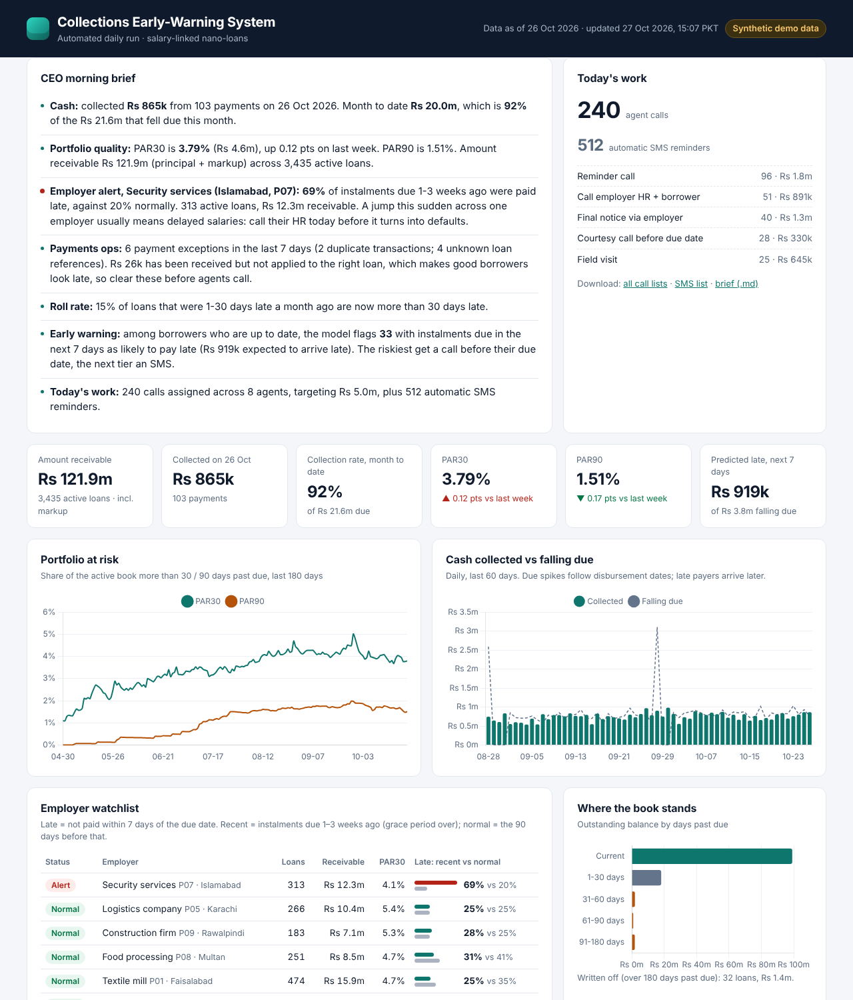
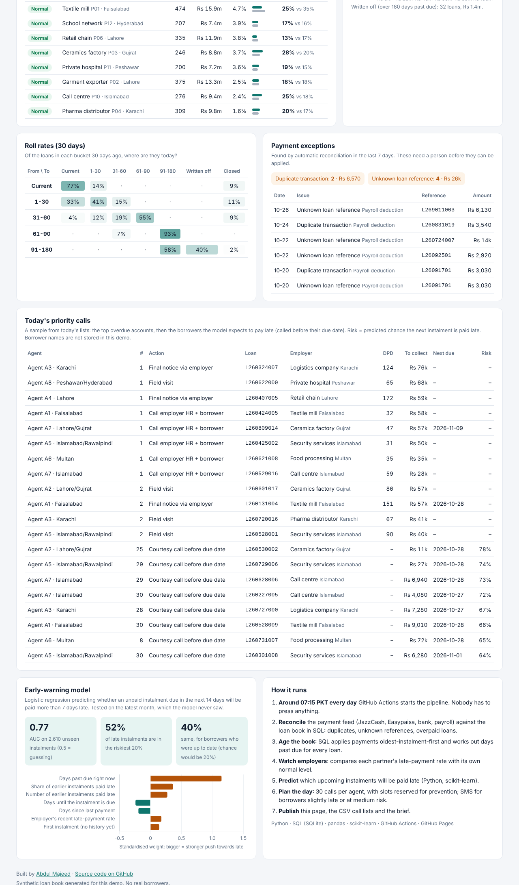
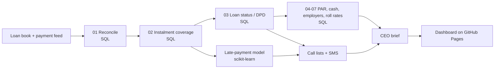

# Loan Collections Early-Warning System

**Live dashboard (updates itself every morning):** https://abdulmajeed-crypto.github.io/loan-collections-early-warning/

A lender's first question every morning is *"are we getting our money back, and who won't pay us next?"*
In most small lenders the answer takes a team half a day: export the payments, match them to loan schedules in Excel, work out who is overdue, build call lists, write a note for management.

This project does all of that automatically, every morning (around 07:15 Pakistan time), for a salary-linked nano-lender with about 4,500 loans across 12 employer partners.



## What it does every morning

| Step | What happens | Built with |
|---|---|---|
| 1. Reconcile payments | Matches the day's JazzCash, Easypaisa, bank and payroll payments to loans. Flags duplicates, unknown references and overpaid loans for the ops team. | SQL |
| 2. Age the book | Applies payments oldest-instalment-first and calculates days past due (DPD), amount overdue and bucket for every loan. | SQL (window functions) |
| 3. Measure portfolio quality | PAR30, PAR90, collection rate, roll rates, write-offs, and a 180-day trend. | SQL + Python |
| 4. Watch employers | Compares each employer's late-payment rate on instalments due 1–3 weeks ago with its own normal level, and raises an alert when it jumps (usually a payroll delay). | SQL |
| 5. Predict who pays late next | A logistic-regression model scores every unpaid instalment due in the next 14 days. | Python, scikit-learn |
| 6. Plan the day | 30 calls per recovery agent: prevention calls for high-risk borrowers *before* they miss, then the most valuable overdue accounts. Borrowers slightly late or at medium risk get an automatic SMS. | Python |
| 7. Brief the CEO | Writes a plain-English summary of what changed and what to do, and publishes the dashboard and CSV call lists. | Python, GitHub Actions, GitHub Pages |

## Sample CEO brief (26 Oct 2026)

- **Cash:** collected **Rs 865k** from 103 payments. Month to date **Rs 20.0m**, which is **92%** of the Rs 21.6m that fell due this month.
- **Portfolio quality:** PAR30 is **3.79%** (Rs 4.6m), up 0.12 pts on last week. PAR90 is 1.51%.
- **Employer alert, Security services (Islamabad):** **69%** of instalments due 1-3 weeks ago were paid late, against 20% normally. 313 active loans, Rs 12.3m receivable. Call their HR today before it turns into defaults.
- **Payments ops:** 6 payment exceptions in the last 7 days; Rs 26k received but not applied to the right loan.
- **Early warning:** among borrowers who are up to date, 33 with instalments due in the next 7 days are flagged as likely to pay late. The riskiest get a call before their due date, the next tier an SMS.
- **Today's work:** 240 calls across 8 agents, plus 512 automatic SMS reminders.

## The early-warning model

- **Predicts:** will an unpaid instalment due in the next 14 days be paid more than 7 days late?
- **Trained the way it is used:** each past instalment is looked at 1–14 days before its due date, and only if it was still unpaid then. Features use only what was known on that day: days past due, share and number of earlier instalments paid late, days until due, days since last payment, the employer's recent late rate, loan size, how far through the loan, first-instalment flag.
- **Tested** on the most recent month, which the model never trained on. In the 26 Oct 2026 run: **AUC 0.77**, and the riskiest 20% of instalments contained **52%** of the late ones. For borrowers who were still up to date (the hard case, and the one prevention calls target), the riskiest 20% contained **40%** of late payers, twice what random calling would find. The live dashboard shows each day's figures.



## How it fits together



A GitHub Actions workflow ([`.github/workflows/daily.yml`](.github/workflows/daily.yml)) runs the tests, runs the pipeline for yesterday's date and publishes the site. The CEO brief also appears in each run's summary. GitHub pauses scheduled workflows in repositories with no activity for 60 days, so the workflow also makes a small "keep-alive" commit on the 1st of each month.

## Repository

```
sql/          the business logic, one numbered step per file
src/          simulator, pipeline runner, model, call-list planner, brief writer
web/          the dashboard page (HTML, CSS, Chart.js)
tests/        unit tests for the SQL on a hand-built loan book with known answers
.github/      the daily schedule
```

## Run it yourself

```bash
pip install -r requirements.txt
python -m unittest discover -s tests -v
python -m src.run_pipeline --as-of 2026-10-26 --out site
# open site/index.html through a local server: python -m http.server -d site
```

## About the data

The loan book is **synthetic**: no real borrowers, employers or payments. It is generated from fixed seeds so every run is reproducible, and it contains the problems real lenders see: late payers, borrowers who stop paying, employer payroll delays, partial payments, duplicate payment messages and payers who type the wrong loan reference. Wrong references that match no loan are flagged; a mistyped reference that happens to match a different real loan is credited to that loan, as it would be in a real system, and shows up later as an overpaid loan. Employer names are generic descriptions, not real companies.

## Definitions

- **DPD (days past due):** days since the oldest instalment that is not fully paid.
- **Amount receivable:** what borrowers still owe, principal plus markup.
- **PAR30 / PAR90:** amount receivable on loans more than 30 / 90 days past due, as a share of the active book. (Lenders often use principal only; with flat markup the ratios are almost the same.)
- **Late:** an instalment not fully paid within 7 days of its due date.
- **Written off:** any instalment more than 180 days unpaid; removed from the active book for good (later payments count as recoveries).
- **Collection rate (month to date):** cash collected this month ÷ instalments that fell due this month.

---

**Abdul Majeed** · Data Analyst · [LinkedIn](https://www.linkedin.com/in/abdul-majeed-memon/) · Also see my [Power BI project on Pakistan's power distribution companies](https://github.com/abdulmajeed-crypto/pakistan-disco-powerbi)
